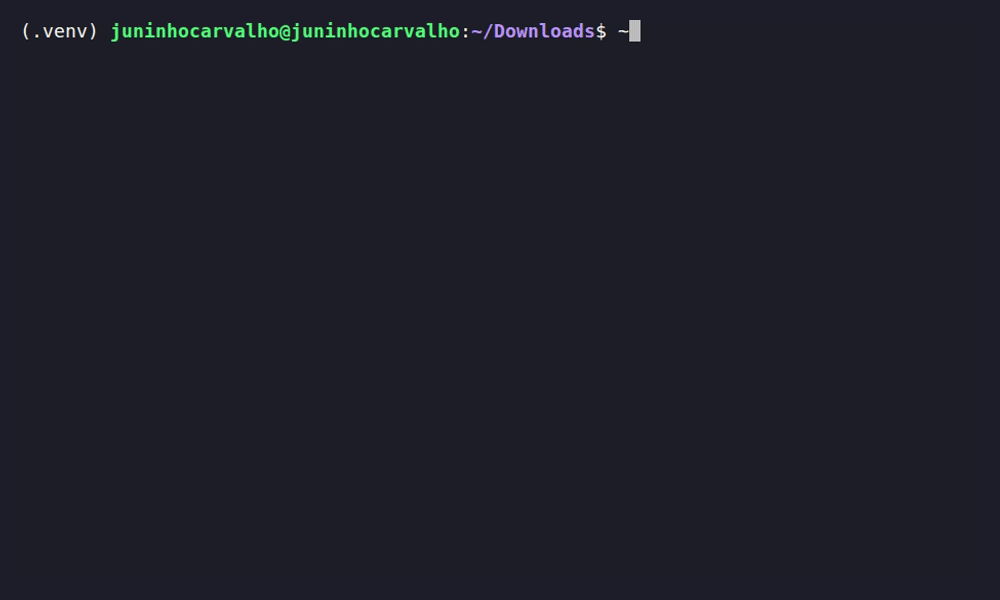

# JC SPEEDTEST

[](https://pypi.org/project/jc-speedtest/)
[](https://pypi.org/project/jc-speedtest/)
[](https://github.com/jacivaldocarvalho/jc-speedtest/actions/workflows/ci.yml)
[](LICENSE)

Lightweight, programmatic internet speed and network performance checks for Telecom, Networking, DevOps, and SRE.

<div align="center">
  
</div>

## Features

* Native download and upload throughput measurements
* Latency (RTT) measurement with TCP/TLS warm-up handling
* JSON output for automation and scripting
* CLI input validation and operational exit codes
* Zero external dependencies beyond `httpx` (by default)
* Optional `speedtest-cli` backend for industry-standard server selection
* Immutable, typed result objects (PEP 561 compliant)

## Use Cases

`jc-speedtest` provides a lightweight, programmatic way to measure internet speed and network quality. It is designed to bypass the overhead, ads, and heavy JavaScript of browser-based speed tests, delivering clean data directly to your terminal or Python code.

### SRE and DevOps

The package can be used to verify bandwidth and latency in CI/CD pipelines, containerized environments, or remote servers where a browser is not available.

Typical use cases include:

* Measuring throughput without downloading a GUI or browser extensions
* Automating network quality checks before deploying heavy artifacts
* Logging bandwidth metrics in JSON for dashboards (Grafana, Datadog)
* Verifying if a network link is degraded or saturated

Example:

```bash
jc-speedtest --json
```

### Networking and Telecommunications Infrastructure

The project focuses on IP layer performance. The native backend uses Cloudflare's global anycast network to measure throughput, ensuring that the request is handled by the Point of Presence (PoP) closest to the probe.

The tool validates the following network layers:

```text
Application
└── HTTP/HTTPS ──> Throughput measurement (Cloudflare API)

Transport
└── TCP ─────────> Latency and TLS handshake overhead
```

It does not currently provide ICMP ping, packet loss analysis, or jitter measurements, but it offers a reliable application-layer view of network health.

### Automation

Structured output makes the package suitable as a building block for operational tools:

```bash
jc-speedtest --json --no-upload
```

The combination of structured results and exit codes allows integration into scripts, CI/CD workflows, and monitoring processes.

## Installation

Requires Python 3.10+.

```bash
pip install jc-speedtest
```

For maximum accuracy on gigabit+ connections (optional):
```bash
pip install jc-speedtest[speedtest]
```

## Usage

```bash
jc-speedtest [--json] [--no-download] [--no-upload] [--timeout SECONDS] [--backend {auto,native,speedtest-cli}]
```

Use `--help` to display available commands:

```bash
jc-speedtest --help
```

### Examples

Basic run:

```bash
jc-speedtest
```

JSON output:

```bash
jc-speedtest --json
```

Skip phases:

```bash
jc-speedtest --no-upload
```

Force the native backend (Cloudflare):

```bash
jc-speedtest --backend native
```

Force the `speedtest-cli` backend (if installed):

```bash
jc-speedtest --backend speedtest-cli
```

## Backends and Architecture Decisions

By default, `jc-speedtest` uses `--backend auto`. In this mode, it **prioritizes the native backend** for speed and zero configuration.

1. **`native` (default in auto)**: Uses Cloudflare's public endpoints via plain HTTP. Zero external dependencies beyond `httpx`. Measures latency (with TCP/TLS warm-up), download, and upload.
2. **`speedtest-cli` (optional)**: Delegates to the well-known `speedtest-cli` package if installed. Provides more accurate results on very fast connections but relies on third-party servers and has a slower startup time.

If you want to use the industry-standard `speedtest-cli` servers, install the extra and force the backend:

```bash
pip install jc-speedtest[speedtest]
jc-speedtest --backend speedtest-cli
```

### Design Decisions

* **Warm-up Request**: The first HTTP request always pays the TCP/TLS handshake cost. We discard this first sample in the latency calculation to report the true network RTT.
* **Granular Timeouts**: We use `httpx.Timeout` with `connect` and `pool` limits for handshakes, but `read` and `write` limits based on inactivity. This prevents false timeouts on slower connections (e.g., downloading 25MB over a 10 Mbps link).
* **Byte Measurement**: The native backend downloads a 25MB file and uploads a 10MB payload. This is enough to saturate most residential connections, but may slightly underestimate gigabit+ links due to single-connection TCP limits.

## Exit Codes

The CLI uses exit codes designed for automation, monitoring and scripting:

| Code | Meaning |
| --- | --- |
| `0` | Measurement completed successfully |
| `1` | Error during measurement (timeout, HTTP failure, etc.) |
| `2` | Invalid CLI usage (argparse default) |

## Python API

```python
from jc_speedtest import run_speedtest

result = run_speedtest(download=True, upload=True, backend="auto")

print(f"Download: {result.download_mbps:.2f} Mbps")
print(f"Upload: {result.upload_mbps:.2f} Mbps")
print(f"Latency: {result.ping_ms:.2f} ms")
print(f"Backend: {result.backend}")
```

## Development

Clone the repository:

```bash
git clone https://github.com/jacivaldocarvalho/jc-speedtest.git
cd jc-speedtest
```

Create a virtual environment:

```bash
python -m venv .venv
source .venv/bin/activate
```

Install development dependencies:

```bash
pip install -e ".[dev]"
pre-commit install
```

Quality checks:

```bash
ruff check .
ruff format --check .
mypy src
pytest --cov
```

Integration tests (hits the real network):

```bash
pytest -m integration
```

## CI/CD

GitHub Actions validates the project with Python 3.10, 3.11, 3.12 and 3.13 using:

* Ruff
* Mypy
* Pytest
* Coverage
* Package build

Releases are published to PyPI using **GitHub Actions, OpenID Connect (OIDC) and PyPI Trusted Publishing**, without long-lived PyPI credentials.

## License

Distributed under the MIT License. See [LICENSE](LICENSE) for more information.

## Author

**Jacivaldo Carvalho**

Telecommunications Engineer | DevOps Engineer | SRE | Networking

[GitHub](https://github.com/jacivaldocarvalho) | [LinkedIn](https://www.linkedin.com/in/jacivaldocarvalho) | [Website](https://www.jacivaldocarvalho.com/)