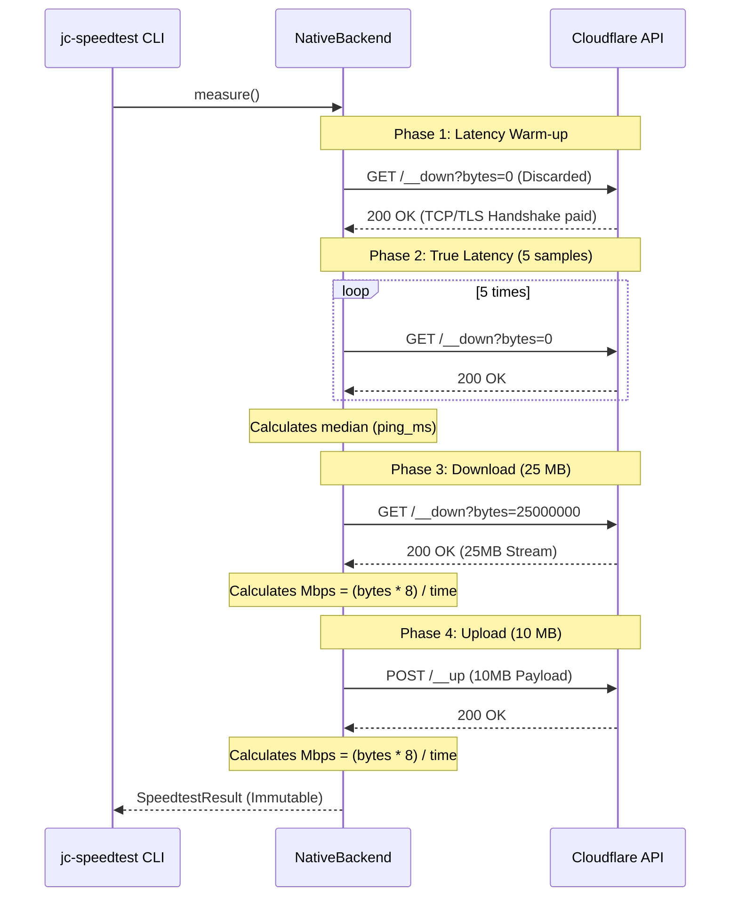

# ADR 001: Measurement Backend Strategy

## Status
Accepted (Updated)

## Context
We need to measure internet speed (latency, download, upload) without a browser.
Two approaches exist:
1. Pure Python using public HTTP endpoints (e.g., Cloudflare).
2. Delegating to established tools like `speedtest-cli` or Ookla's binary.

The tool is intended for use in SRE, DevOps, and Telecom environments where CLI startup time, package size, and zero-configuration execution are critical.

## Decision
Use a **hybrid approach**, but with a clear prioritization to ensure the tool is fast and lightweight out-of-the-box.

- **Native (Default for `--backend auto`)**: The package uses Cloudflare's public endpoints via `httpx` by default. This requires zero external dependencies (beyond `httpx`) and starts immediately.
- **Optional (`--backend speedtest-cli`)**: If the user explicitly wants industry-standard server selection (Ookla network) and installs the extra `jc-speedtest[speedtest]`, the tool can delegate to the `speedtest-cli` package.

The `speedtest-cli` dependency is **strictly optional**. The `auto` mode will **never** automatically select `speedtest-cli` just because it is installed in the environment. It must be explicitly requested by the user.

### Native Measurement Flow

The sequence below illustrates how the native backend interacts with Cloudflare's endpoints, including the TCP/TLS warm-up phase and the subsequent measurements.

## Consequences
- **Pros**:
  - The package remains lightweight by default (only depends on `httpx`).
  - Fast startup time for automated scripts and CI/CD pipelines (no Python overhead of loading Ookla's multi-server libraries).
  - Predictable behavior: the user knows exactly which backend is being used unless they override it.
- **Cons**:
  - Users needing maximum accuracy on gigabit+ connections must manually opt-in by installing the extra and passing `--backend speedtest-cli`.
  - Upload measurement in native mode (single TCP stream) may be slightly less accurate than dedicated tools that use multiple parallel connections.
  - Clear documentation is required so users understand why `speedtest-cli` is not selected automatically.
